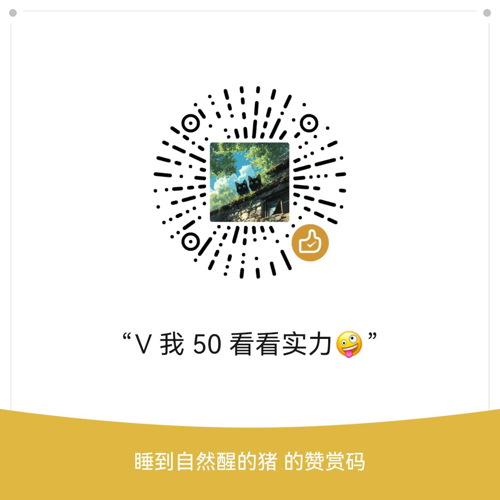

# ICT 认证与软考笔记本（ict-certifications）

> 把「厂商数通认证」与「软考中级 / 高级」的考纲、命令与考点，重构成可学、可查、可上机落地的备考笔记库。
> 
> 本仓库覆盖两类目标：一类是**厂商认证**（华为、思科、H3C、中兴、浪潮、迈普、锐捷的数通方向三级认证），按「原理 → 命令 → 配置实例 → 验证 → 排障 → 考点速记」展开；一类是**软考**（数据库、网络、软件设计师、信息系统项目管理师），按「考点 → 题型 → 模板 → 真题」组织。每篇都追求"拿来能配、上机能验、进考场能答"。

## 协议（CC BY 4.0）

### 协议摘要

> 本仓库整理内容采用 **CC BY 4.0（知识共享署名 4.0 国际许可协议）**。
> 
> 您可以自由分享、改编本仓库整理的资料（含商业使用）；分发、二次加工时须**标注来源（BY）**。所引厂商文档、教材、考纲与官方文件的著作权归原作者与权利人所有，协议仅适用于本仓库的整理汇编成果。

### 完整协议

[CC BY 4.0 知识共享署名 4.0 国际许可协议](https://creativecommons.org/licenses/by/4.0/deed.zh) · 全文见仓库根目录 [LICENSE](LICENSE)

## 请我喝杯咖啡

|     微信赞赏码     |       支付宝        |       支付宝红包        |
| :----------------: | :-----------------: | :-----------------: |
|  | | |
