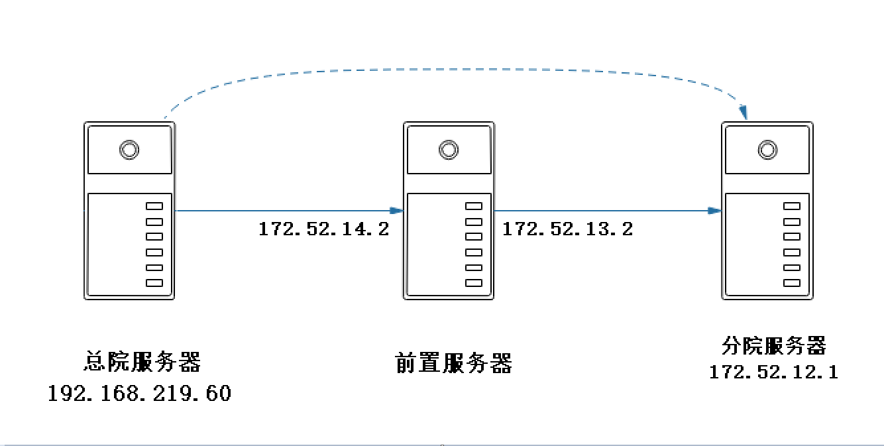
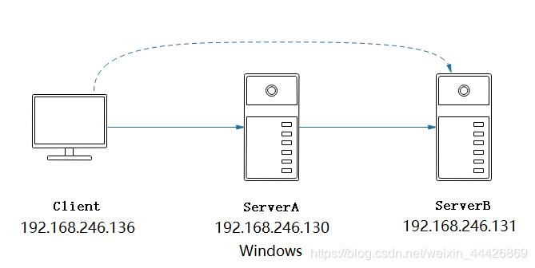

# Windows 端口转发（netsh portproxy）

本文整理 `netsh interface portproxy` 的常用命令与两个配置示例。文档中的示例均使用 `v4tov4`（IPv4 到 IPv4）转发，协议为 TCP。

## 一、常用命令

### 1. 查看所有转发规则

```cmd
C:\>netsh interface portproxy show all
```

未配置时无输出。配置后的输出格式：

```text
侦听 ipv4:                 连接到 ipv4:
地址            端口        地址            端口
--------------- ----------  --------------- ----------
*               10022       192.168.2.53    22
```

### 2. 添加转发规则

本机监听 10022 端口，收到连接后转向 `192.168.2.53:22`。`listenaddress=*` 表示接受任意本机地址的连接。

```cmd
C:\>netsh interface portproxy add v4tov4 listenport=10022 connectaddress=192.168.2.53 connectport=22 listenaddress=* protocol=tcp
```

### 3. 删除单条规则

按监听端口、监听地址和协议定位要删除的规则：

```cmd
C:\>netsh interface portproxy delete v4tov4 listenport=10022 listenaddress=* protocol=tcp
```

### 4. 清空所有转发规则

```cmd
netsh interface portproxy reset
```

### 5. 查看帮助

```cmd
C:\>netsh interface portproxy /?
C:\>netsh interface /?
C:\>netsh /?
```

## 二、示例：把 ServerA 的 8888 端口转发到 ServerB 的 6666 端口

拓扑：Client → ServerA（`192.168.246.130:8888`）→ ServerB（`192.168.246.131:6666`）。

原文截图：





### 步骤

1. 在 ServerA 上添加转发规则：

   ```cmd
   netsh interface portproxy add v4tov4 listenaddress=192.168.246.130 listenport=8888 connectaddress=192.168.246.131 connectport=6666
   ```

2. 添加防火墙入站规则。原文说明：防火墙默认阻挡入站通信，因此需要放行 8888 端口：

   ```cmd
   netsh advfirewall firewall add rule name="transmit" protocol=TCP dir=in localport=8888 action=allow
   ```

3. 在 ServerB 上监听 6666 端口：

   ```cmd
   nc.exe -lvp 6666
   ```

4. 在 Client 上连接 ServerA 的 8888 端口：

   ```cmd
   nc 192.168.246.130 8888
   ```

## 三、示例：测试环境

前置服务器地址 `192.168.0.164`，转发到 `192.168.0.112`。

1. 添加转发规则：

   ```cmd
   netsh interface portproxy add v4tov4 listenaddress=192.168.0.164 listenport=8888 connectaddress=192.168.0.112 connectport=6666
   ```

2. 添加防火墙入站规则：

   ```cmd
   netsh advfirewall firewall add rule name="transmit" protocol=TCP dir=in localport=8888 action=allow
   ```

3. 在 ServerB 上监听 6666 端口：

   ```cmd
   nc.exe -lvp 6666
   ```

4. 在 Client 上连接 ServerA 的 8888 端口：

   ```cmd
   nc 192.168.0.164 8888
   ```

5. 清理：先 `netsh interface portproxy reset` 删除全部转发，再按需重新添加，例如：

   ```cmd
   netsh interface portproxy add v4tov4 listenaddress=192.168.0.164 listenport=8888 connectaddress=192.168.10.112 connectport=6666
   ```
